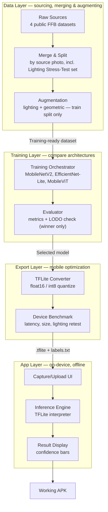

# System Architecture — Palm Oil Ripeness Detection

**Smartphone-Based Palm Oil Ripeness Detection Using Lightweight Vision Models**
Design doc — August 2026. Companion to `PROJECT_PLAN.md` and `CLAUDE.md`.

## 1. Purpose

`PROJECT_PLAN.md` describes phases and milestones. This document describes the *system* those phases build: what components exist, what each one does, how data flows through them, and exactly what gets built vs. trained in each phase. Fully on-device — no backend/server component; the app bundles the model and runs inference locally.

## 2. Architecture Overview

Four layers, data flowing top to bottom. Each layer's output is the next layer's input.

## 3. Component Breakdown

### Data Layer
- **Raw Sources** — the 4 public datasets as downloaded (Bunch Piles, Outdoor-Tenera, Mendeley, Kaggle). Input: none (external). Output: raw images + original annotations per source.
- **Merge & Split** — crops the Bunch Piles YOLO boxes into classification patches, maps every source onto the **final 4-class taxonomy (unripe / underripe / ripe / overripe)**. Bunch Piles' "empty bunch" and "abnormal fruit" images and Mendeley's "Decayed" category are excluded during this step — they fall outside the fixed 4-class scope. Pools everything with a `source` column kept on every row, splits train/valid/test **by source photo** (never by crop — this is the exact bug that leaked the FYP1 baseline). Also generates a deterministic **Lighting Stress-Test** set: fixed brightness/shadow transforms applied to the clean test images once, versioned as its own artifact — used for robustness evaluation, never randomly re-generated. Input: Raw Sources. Output: Unified Dataset (train/valid/test) + Lighting Stress-Test set.
- **Augmentation** — random, on-the-fly lighting (simulated shadow/low-light/brightness) and geometric (flip/rotate/crop) augmentation, applied **only to the training split**. Validation, test, and the Lighting Stress-Test set stay untouched so they remain a clean, reproducible measure of performance. Input: Unified Dataset (train). Output: Training-ready dataset.

### Training Layer
- **Training Orchestrator** — runs the same training recipe (transfer learning, class-weighted/focal loss, label smoothing) across MobileNetV2, EfficientNet-Lite, and MobileViT, logging each run's config/metrics under `results/<run-name>/`. Input: Training-ready dataset. Output: one trained checkpoint per architecture.
- **Evaluator** — scores every checkpoint on accuracy/F1/ROC-AUC/inference time against the clean test set and the Lighting Stress-Test set. Runs a **leave-one-dataset-out (LODO) generalization check on the winning architecture only**: 4 extra runs, each holding out one whole source entirely (train on the other 3, test purely on the held-out one), cycling through Bunch Piles, Outdoor-Tenera, Mendeley, and Kaggle in turn. Input: checkpoints + Unified Dataset. Output: comparison table + the Selected Model + LODO generalization results.

### Export Layer
- **TFLite Converter** — converts the Selected Model to `.tflite`, applies float16 and int8 quantization. Input: Selected Model. Output: quantized candidates.
- **Device Benchmark** — measures real file size, on-device latency, and re-scores against the Lighting Stress-Test set, on an actual phone. Input: quantized candidates. Output: deployment-ready `.tflite` + `labels.txt` meeting all 5 NFRs.

### App Layer
- **Capture/Upload UI** — user photographs or picks a bunch image.
- **Inference Engine** — TFLite interpreter wrapper, loads the bundled model, runs on-device.
- **Result Display** — renders the ripeness call and per-class confidence bar per the FYP1 mockups.

## 4. Data Flow

The 4 raw sources feed *Merge & Split*, which outputs the Unified Dataset manifest (path, class, source, split) plus physical train/valid/test folders, plus the separate deterministic Lighting Stress-Test folder. *Augmentation* wraps the train folder only, on-the-fly at training time — the original source images stay the ground truth, nothing is pre-baked. *Training Orchestrator* trains all 3 architectures on augmented train, validates on clean valid, producing 3 checkpoints.

*Evaluator* scores each checkpoint on the clean test set (the headline number against the ≥85% NFR) and the Lighting Stress-Test set (robustness). The leave-one-dataset-out (LODO) check runs after a winner is picked, cycling through all 4 sources as the held-out set in turn — this is the project's primary generalization evidence, not a backup, since MPOB field data isn't expected in time to anchor the timeline around it. Selected Model → *TFLite Converter* → quantized candidates → *Device Benchmark* → final `.tflite` + `labels.txt`, bundled into the app at build time. From there, every image through *Capture/Upload UI → Inference Engine → Result Display* is a live, real-world photo, never anything from train/valid/test. MPOB field images, if they materialize, get folded into Phase 5's Extended Evaluation as a bonus real-world check — the plan does not depend on them arriving.

## 5. Evaluation Protocol — Two Different Splits, Not to Be Confused

| | Main split | Leave-one-dataset-out (LODO) check |
|---|---|---|
| **How it's built** | All 4 datasets pooled, shuffled, split by source *photo* — every dataset contributes to train, valid, and test | Each of the 4 datasets held out *entirely* in turn; the other 3 are entirely train, repeated 4 times |
| **What it answers** | "How accurate is the model on an unseen photo from any of these sources?" | "Does the model still work on a camera/location it has never encountered at all?" — across all 4 sources, not just one |
| **Used for** | The headline accuracy number against the ≥85% NFR; picks the winning architecture | **Primary generalization evidence** for the project, run on the winner only, in Phase 2 |
| **Cost** | Required for all 3 architectures | 4 extra training runs, winner only — not run per-architecture |

This project does not plan around MPOB field data arriving in time — it's treated as a bonus real-world check folded into Phase 5 if it materializes, not a dependency. The LODO check is the project's actual generalization claim: a model that holds up reasonably well across 4 independently-collected datasets is solid evidence on its own, consistent with treating this as a research-style comparison study.

## 6. Phase → Component Mapping

| Phase | Component(s) built | What's trained / run | Acceptance criteria before moving on |
|---|---|---|---|
| 0 (wk 1–2) | Repo scaffolding for all 4 layers; nothing functional yet | Nothing | All 4 candidate datasets downloaded, licensed, spot-checked |
| 1 (wk 3–6) | Data Layer complete: Raw Sources → Merge & Split → Augmentation | Nothing trained — this phase produces data, not models | Zero leakage verified (no source photo split across train/valid/test); Lighting Stress-Test artifact exists; class taxonomy finalized |
| 2 (wk 7–9) | Training Layer: Training Orchestrator + Evaluator | MobileNetV2, EfficientNet-Lite, MobileViT — all 3 on the main split; LODO check on the winner only (4 runs, each source held out in turn) | Best model scores against ≥85% NFR (or gap documented with error analysis); LODO results recorded for all 4 sources |
| 3 (wk 10–11) | Export Layer: TFLite Converter + Device Benchmark | Nothing new trained — Selected Model is converted, not retrained | ≤100MB, ≤2s on real device, Lighting Stress-Test score holds up post-quantization |
| 4 (wk 12–14) | App Layer: Capture/Upload UI, Inference Engine, Result Display | Nothing trained — integration work | Working APK, capture → inference → result loop runs end-to-end |
| 5 (wk 15–16) | Nothing new built — Extended Evaluation of the whole stack | Nothing trained — deeper error analysis on the LODO results, optional ablation (e.g. with/without augmentation, with/without label smoothing); MPOB field images folded in as a bonus check only if available | LODO results and error analysis written up; limitations documented honestly; MPOB test included if it arrived in time |
| 6 (wk 17–19) | N/A | N/A | Thesis + viva deck reflect the architecture and both generalization results |

## 7. Decisions Log

- **Taxonomy: locked to 4 classes** (unripe/underripe/ripe/overripe). Bunch Piles' empty/abnormal and Mendeley's Decayed categories are excluded at Merge & Split.
- **MPOB field data: not a dependency.** The project doesn't plan around it arriving before Phase 2 ends; it's folded into Phase 5 as a bonus check if available. The leave-one-dataset-out check across all 4 public sources is the project's primary generalization evidence instead.

## 8. Open Questions

- Does Augmentation's lighting simulation need to match the *specific* brightness range used in the Lighting Stress-Test set, so train-time augmentation and eval-time stress-test are calibrated to the same real-world range rather than arbitrary values?
