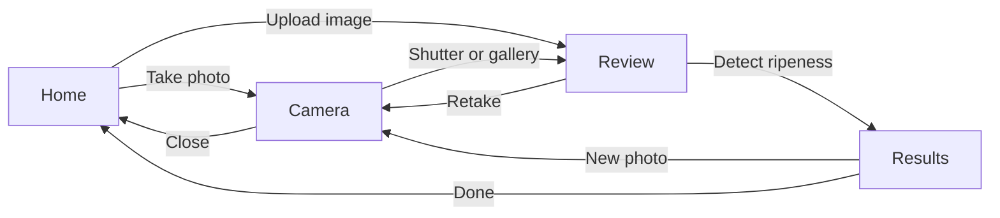

# Palm Ripeness App: Developer Handoff

> Snapshot of the Claude doc "Palm Ripeness App: Developer Handoff" as of 2026-09-21. The Claude doc is the master: https://claude.ai/code/artifact/5d09ae0d-e781-4830-b01f-b37c6aff2e92
> Design canvas (private, owner only): https://claude.ai/artifact/FaAA3dueVpg2UDKrsgQunK
> Decisions and rationale: see `DESIGN_NOTES.md` in this folder.

## Overview

Build four screens in Kotlin for Android: Home, Camera, Review and Results. Each photographs one oil palm fruit bunch and names its ripeness stage on the phone, with no network. The reference size is 360 × 800 dp; sizes below are dp and text sizes are sp.

Upload image and the gallery button both open the system picker, then land on Review. The screens are drawn on the design canvas with six extra state boards (errors, low light, analysing, close call); the canvas is private to its owner. The model is the exported `.tflite` and `labels.txt` bundled in the APK; the report recommends FastViT_T8 at float16 (6.1 MB), and the on-device benchmark is still outstanding.

## Design tokens

Use these names in the Android theme. Green means ripe and nothing else, so no button or accent uses it.

| Token | Hex | Use |
| --- | --- | --- |
| ground | #F3EEE2 | Screen background on Home and Results |
| card | #FFFCF5 | Chart card |
| sand | #E7DEC6 | Home stage card, close-call notice, unreadable-photo placeholder |
| ink | #1A271D | Text, primary button fill, outline buttons, focus ring on light screens |
| ink-2 | #4B584D | Secondary text (6.5:1 on ground) |
| track | #E6DEC9 | Chart column track, progress track |
| line | #E2D9C4 | Chart card border, 1 dp |
| cam | #131C16 | Camera, Review, photo card background |
| cam-photo | #1B271F | Review photo area |
| stage-unripe | #B3261E | Red, unripe |
| stage-underripe | #A86A00 | Amber, underripe |
| stage-ripe | #2F7A3E | Green, ripe |
| stage-overripe | #4A3428 | Brown, overripe |
| focus-dark | #F0B429 | Focus ring on camera and Review |
| disabled | #D9D1BC fill, #5A655C text | Disabled buttons on Home |
| overlay | rgba(11,16,12,0.62) | Camera round buttons; hint pill uses 0.78 |

| Text style | Font | Size / line height | Weight |
| --- | --- | --- | --- |
| Verdict (stage name) | Fraunces | 54 / 1.0 | 600 |
| Screen H1 (Analysing, Unreadable) | Fraunces | 34 / 1.1 | 600 |
| Home H1 | Fraunces | 30 / 1.15 | 600 |
| Review title | Fraunces | 24 | 600 |
| Wordmark, "Result" title | Fraunces | 22 | 600 |
| Body | Instrument Sans | 16 / 1.5 | 400 |
| Primary button | Instrument Sans | 18 | 600 |
| Outline button | Instrument Sans | 17 | 600 |
| Confidence line | Instrument Sans | 18 / 1.3, tabular figures | 400 |
| Chart value, chart title | Instrument Sans | 15 | 400, top stage 600 |
| Supporting text, chart label | Instrument Sans | 14 | 400 |

Bundle both fonts in the APK. The app requests no network permission, so downloadable fonts will not load.

| Spacing and shape | Value |
| --- | --- |
| Screen side padding | 20 dp |
| Top padding | 52 dp |
| Bottom padding | 20 dp (Home 24, camera controls 40) |
| Button radius | 14 dp |
| Card radius | 20 dp (Home stage card 24) |
| Notice radius | 14 dp |
| Chart track radius | 8 dp |
| Camera round buttons | 50% (gallery button 16 dp) |

## Screens

Each list runs top to bottom. "Flexible space" is a spacer that shrinks to a minimum of 16 dp on shorter phones; if the content still does not fit, let the screen scroll.

### Home

- Wordmark "Palm Ripeness" as text, 32 dp row. No logo.
- Stage card, 20 dp below, radius 24, padding 14 / 12: caption "The four stages it tells apart" (14 sp, ink-2), then four equal columns. Each column has a 64 × 77 dp bunch image over the stage name (14 sp, 600): Unripe, Underripe, Ripe, Overripe. The images are stand-ins for real photos.
- H1 "Which stage is this bunch in?", 24 dp below. Body text 10 dp below.
- Flexible space.
- Take photo: primary button, 60 dp high, opens Camera.
- Upload image: outline button, 56 dp high, 12 dp below, opens the system picker.
- Status text, 16 dp below, centred, 14 sp: "Model ready · works offline".

### Camera

- Full-bleed live preview on cam.
- Framing guide: four white corner brackets, 4 dp stroke, 40 dp arms, on a 280 × 360 dp frame centred horizontally, top edge 150 dp from the screen top.
- Flash toggle: 48 dp circle, 20 dp from the right edge, 52 dp from the top.
- Hint pill: centred, top edge at 530 dp, max width 300 dp, padding 10 / 16, radius 20, 15 sp / 500, white on overlay 0.78. Default text "Fill the frame with one bunch".
- Bottom row, 40 dp from the bottom, 20 dp side margins: gallery button 56 dp (radius 16, 2 dp white border at 75%), shutter 84 dp (4 dp white ring around a 64 dp white disc), close button 56 dp circle. Spaced evenly.

### Review

- Photo area fills the top 640 dp on cam-photo. Show the captured or chosen image, fitted and centred.
- Title "Check the photo" (24 sp) and line "Is the bunch sharp and fully in frame?" (16 sp, white at 86%), 20 dp from the sides, 52 dp from the top, over the photo.
- Bottom row, 40 dp from the bottom: Retake (outline, white 2 dp border, weight 1) and Detect ripeness (ground fill, ink text, weight 2), both 60 dp high, 12 dp apart.

### Results

- Title "Result" (22 sp), 36 dp row.
- Photo card, 12 dp below, 152 dp high, radius 20, cam background, the analysed photo fitted and centred.
- Verdict, 20 dp below: a 20 dp dot in the stage colour, 12 dp gap, then the stage name at 54 sp. Under it, 6 dp gap, "Model confidence 96.4%" (18 sp, ink-2).
- Close-call notice (only when triggered), 12 dp below: see States.
- Chart card, 20 dp below, padding 14, radius 20, 1 dp line border. Title "Model confidence by stage" (15 sp / 600), then four equal columns 6 dp apart, in ripeness order. Each column is the percentage on top, a 96 dp tall track with a fill rising from the bottom equal to the score, then the stage name.
- Flexible space.
- Button row: Done (outline, 56 dp, weight 1) to Home, New photo (primary, 56 dp, weight 2) to Camera, 12 dp apart.
- Footnote, 12 dp below, centred, 14 sp: "Analysed on this phone. Nothing was uploaded."

## Components

Six reusable pieces cover every screen.

| Component | Spec | States |
| --- | --- | --- |
| Primary button | ink fill, ground text, 18 sp / 600, radius 14, 56 or 60 dp high, full width or weighted 2 in a row | Pressed: darken fill 10%. Disabled: disabled fill and text. Focused: 3 dp ink ring, 3 dp offset |
| Outline button | transparent, 2 dp ink border, ink text, 17 sp / 600, radius 14, 56 dp high (60 on Review) | Pressed: ink at 8% fill. Disabled: as primary. On dark screens the border and text are white and the focus ring is focus-dark |
| Camera round button | 48 to 56 dp, overlay 0.62 fill, white icon (24 dp) | Flash on: white fill, ink icon, label "Flash on". Flash off: overlay fill, white icon with slash, label "Flash off" |
| Shutter | 84 dp, 4 dp white ring, 64 dp white disc | Pressed: disc scales to 56 dp |
| Stage column | Value above, 96 dp track (track colour, radius 8), fill in the stage colour from the bottom equal to the score, name below | Top stage: value and name at weight 600. All heights are true, with no minimum, so a 0.3% score is nearly empty |
| Notice box | Radius 14, padding 14 / 16, 15 sp / 1.4, 22 dp filled info icon at the left. Ink fill with ground text for errors; sand fill with ink text for the close call | Static |

Icons on icon-only buttons are custom and heavier than a stock outline set: close is a 3 dp square-capped cross, flash is a filled bolt, gallery is a framed picture with a filled hill. Buttons with text have no icon.

## States and errors

Six states are drawn on the canvas. Copy is final unless marked.

| State | Screen | Trigger | What shows | Actions |
| --- | --- | --- | --- | --- |
| Model not loaded | Home | The TFLite interpreter fails to load at start | Ink notice: "The model did not load. Close the app and open it again. Photos cannot be analysed until it loads." Status text becomes "Model not loaded" | Both buttons disabled |
| Camera access off | Camera | Camera permission denied | Heading "Camera access is off", body "Palm Ripeness needs the camera to photograph a bunch. Photos stay on this phone." | Open settings (app settings screen); Upload an image instead (system picker, then Review) |
| Low light | Camera | Preview brightness below a threshold (not yet defined) | Hint pill reads "Too dark. Turn on the flash or move into light." | Flash toggle and shutter stay active |
| Analysing | Results | Inference is running | Heading "Analysing photo", a determinate progress bar (0 to 100) with the percentage, and "The model runs on your phone, so this works without signal. The photo is not uploaded." | Cancel returns to Review |
| Photo unreadable | Results | Image fails to decode, or the model rejects the input | Heading "This photo could not be read", body "The image may be blurred, too dark, or in a format the app cannot open. Take another photo with the whole bunch in frame." | Take another photo (Camera); Choose another image (picker, then Review) |
| Close call | Results | Top two scores are less than 15 points apart | Sand notice under the confidence line: "Close call. 45.0% underripe. Check the bunch by eye." The first number is the second-highest score and stage | None |

Run inference on a background thread so the screen never looks frozen.

## Behaviour and data

The Results screen needs four scores from the model, one per stage, and nothing else.

- **Input:** a 224 × 224 RGB image, the size the model was trained on.
- **Output:** four scores in the order of `labels.txt`: unripe, underripe, ripe, overripe. Read the order from the file, not from code.
- **Display:** show each score as a percentage to one decimal place. The top stage is the highest score.
- **Column height:** the score as a percentage of the 96 dp track.
- **Close call:** show the notice when the top score minus the second-highest is less than 15 points.
- **Wording:** the score is labelled "Model confidence", as in the report.

| From | Action | To |
| --- | --- | --- |
| Home | Take photo | Camera |
| Home | Upload image | System picker, then Review |
| Camera | Shutter | Review with the captured frame |
| Camera | Gallery button | System picker, then Review |
| Camera | Close | Home |
| Camera | Flash | Toggles the torch, stays on Camera |
| Review | Retake | Camera |
| Review | Detect ripeness | Results (analysing, then result or unreadable) |
| Results | New photo | Camera |
| Results | Done | Home |

Constraints from the report:

- No network permission in the manifest, so the offline claim can be checked there.
- No account, no history and no upload. Nothing leaves the phone.
- Model and `labels.txt` are bundled at build time, and so are both fonts.

## Accessibility and open questions

All text passes 4.5:1 contrast, measured on the final colours; the four stage colours pass 3:1 against the chart card and the amber against the track is 3.3:1.

- **Screen reader labels:** close is "Close camera", flash announces "Flash on" or "Flash off" as a toggle, gallery is "Choose an image from the gallery", shutter is "Take photo". Each chart column reads as "Ripe, 96.4 percent", and the verdict reads as "Ripe, model confidence 96.4 percent". The bunch drawings are decorative.
- **Touch targets:** every control is at least 48 dp; buttons are 56 to 60 dp.
- **Focus:** a 3 dp ring with 3 dp offset, ink on light screens and focus-dark on camera and Review.
- **Colour blindness:** red and green are hard to tell apart for some people, so the stage name is always written out, and the columns always run unripe to overripe left to right.
- **Text scaling:** check the layouts at 130% font size; the Home H1 and the chart labels are the tightest.

Open questions:

- [ ] Is 15 points the right close-call threshold? It is a design assumption, not taken from your validation results.
- [ ] The report lists 47.2 ms for FastViT_T8 float16, from the conversion spike, not a phone. Inference this fast makes a progress bar barely visible; show the Analysing screen for a minimum time, or skip it?
- [ ] What brightness measure and threshold trigger the low-light hint?
- [ ] Pressed and disabled styles for buttons are proposed here, not drawn on the canvas.
- [ ] Replace the bunch drawings with real photos once their licence allows it.
- [ ] The FYP1 mockup used a leaf logo and the name "Palm Oil Ripeness Detector"; this design uses a text wordmark only.
